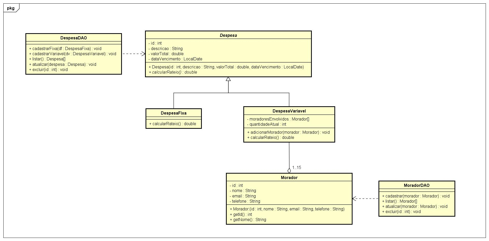
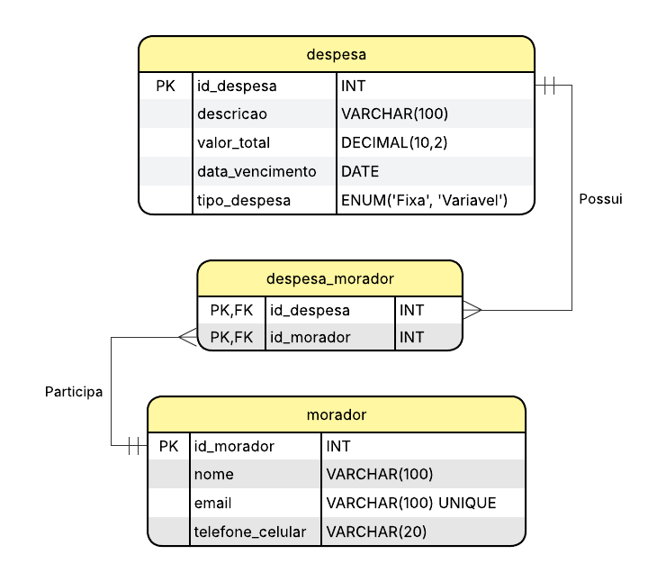

# SplitShare - Conciliador Financeiro para Moradias Compartilhadas

Aplicação da AEP para dividir despesas em moradias compartilhadas.

**Integrantes:** Gabriela Marotti dos Santos, Lorena de Oliveira Dias e Maria Eduarda de Oliveira Carvalho  
**Tema ODS 11:** Cidades e Comunidades Sustentáveis

## Lista de Requisitos Funcionais

| ID | Descrição do Requisito |
| :--- | :--- |
| **RF01** | O sistema deve permitir o gerenciamento (cadastro, edição e exclusão) de moradores, contendo apenas nome, e-mail e telefone celular. |
| **RF02** | O sistema deve permitir o cadastro de "Despesas Fixas" (ex: Aluguel), informando descrição, valor total e data de vencimento, dividindo o valor automaticamente entre todos os moradores cadastrados. |
| **RF03** | O sistema deve permitir o cadastro de "Despesas Variáveis" (ex: Mercado), permitindo vincular especificamente quais moradores (relação 1:N) farão parte daquela divisão. |
| **RF04** | O sistema deve permitir a listagem (leitura) de todas as despesas cadastradas no banco de dados, exibindo o valor total e o valor da fração calculada. |
| **RF05** | O sistema deve permitir a edição e a exclusão de despesas cadastradas, para caso o morador tenha lançado algum valor ou data de forma incorreta. |

## Cronograma de Execução

| Data Prevista | Atividade (Etapa de Desenvolvimento) | Responsável |
| :---: | :--- | :---: |
| 4° semana/ago | Levantamento de Requisitos, Definição do Escopo e Alinhamento ODS | Gabriela, Lorena e Maria Eduarda |
| 4° semana/ago | Criação do Repositório GitHub, Estruturação de Pastas (/src, /docs, /database) e arquivo README.md | Lorena |
| 1° semana/set | Elaboração dos Diagramas (Diagrama de Classes e Diagrama do Banco de Dados - DER) | Maria Eduarda |
| 1° semana/set | Redação Final do Documento em PDF (Justificativa Técnica e Arquitetural) | Gabriela |
| **11/09/2026** | **Submissão da 1ª Entrega (Concepção e Arquitetura)** | **Equipe Completa** |
| 4° semana/set | Criação dos Scripts SQL (DDL) no MySQL e Estruturação do Banco | Gabriela |
| 1° semana/out | Implementação das Classes Java (Aplicando Herança e Polimorfismo) | Lorena |
| 1° semana/out | Desenvolvimento do CRUD e Conexão da Aplicação com o Banco de Dados | Maria Eduarda |
| 3° semana/out | Testes de Integração, Correção de Bugs e Commit Final no GitHub | Gabriela, Lorena e Maria Eduarda |
| **13/11/2026** | **Submissão da 2ª Entrega (Software Funcional e Integrado)** | **Equipe Completa** |

## Diagrama de Classes


## Diagrama de Banco de Dados (DER)


## Como executar no Windows

### 1. Instalar as ferramentas

- **JDK 17 ou superior** para compilar e executar o Java. Uma opção é o [Microsoft OpenJDK](https://learn.microsoft.com/java/openjdk/download).
- **Maven 3.9 ou superior** para baixar as dependências e gerar o programa. Baixe o arquivo binário ZIP, extraia e adicione a pasta `bin` do Maven ao `Path` nas variáveis de ambiente do Windows. Configure `JAVA_HOME` com a pasta do JDK e inclua `%JAVA_HOME%\bin` no `Path`. Veja o [guia do Maven](https://maven.apache.org/install).
- **MySQL Server 8.0.16 ou superior** e **MySQL Workbench**. Instale e configure o servidor, anotando a porta e a senha do administrador. O Workbench será usado para preparar o banco. [Downloads do MySQL](https://dev.mysql.com/downloads/).

Abra uma nova janela do **PowerShell** e confira:

```powershell
java -version
javac -version
mvn -version
```

Os dois primeiros devem mostrar Java 17 ou superior. O Maven também deve indicar um JDK compatível.

### 2. Baixar e abrir a pasta do projeto

1. Na página deste repositório, selecione a branch `main`.
2. Clique em **Code → Download ZIP** e extraia o arquivo.
3. Abra a pasta extraída que contém `pom.xml`, `src` e `database`.
4. Clique na barra de endereço do Explorador de Arquivos, digite `powershell` e pressione Enter.
5. Execute `Get-Location` para conferir a pasta atual e `Test-Path .\pom.xml`. O segundo comando deve retornar `True`.

### 3. Criar o banco no MySQL

1. Inicie o MySQL Server. No Windows, abra **Serviços** e inicie o serviço correspondente à sua instalação do MySQL, se estiver parado.
2. Abra o Workbench e conecte-se ao servidor local usando a conta de administrador.
3. Abra o arquivo `database/schema.sql` pelo botão **Open a SQL script file**.
4. Execute o script inteiro pelo botão de raio que executa a seleção ou todo o conteúdo quando nada está selecionado. Confira se houve sucesso no painel de resultados. [Referência do Workbench](https://dev.mysql.com/doc/workbench/en/wb-sql-editor-toolbar.html).
5. Em uma nova aba SQL, execute:

```sql
USE splitshare;
SHOW TABLES;
```

Devem aparecer `morador`, `despesa` e `despesa_morador`.

### Alternativa local com XAMPP e phpMyAdmin

No XAMPP, inicie **Apache** e **MySQL**. Abra `http://localhost/phpmyadmin`, selecione **Importar** e carregue `database/schema.sql`. O XAMPP pode usar MariaDB mesmo com o botão chamado MySQL.

Se o seu banco local usa `root` sem senha, execute cada linha abaixo separadamente no PowerShell aberto na pasta do projeto e siga direto para o passo 6:

```powershell
$env:SPLITSHARE_DB_URL = 'jdbc:mysql://127.0.0.1:3306/splitshare'
$env:SPLITSHARE_DB_USER = 'root'
Remove-Item Env:SPLITSHARE_DB_PASSWORD -ErrorAction SilentlyContinue
```

Ajuste a porta se necessário. Quando a variável de senha estiver ausente ou vazia, o programa envia uma senha vazia. Uma senha configurada continua sendo utilizada. No PowerShell 5.1, atribuir `''` remove a variável e também funciona com esta versão.

Use `root` sem senha apenas no ambiente local de desenvolvimento. Para ambientes compartilhados, configure a conta com permissões limitadas descrita a seguir.

### 4. Criar o usuário da aplicação

Na conexão administrativa do Workbench, execute o SQL abaixo **uma vez**, substituindo o texto da senha por uma senha sua:

```sql
CREATE USER 'splitshare_app'@'localhost' IDENTIFIED BY 'SUBSTITUA_PELA_SUA_SENHA';
GRANT SELECT, INSERT, UPDATE, DELETE ON splitshare.* TO 'splitshare_app'@'localhost';
```

Se essa conta já existir, use a senha e as permissões configuradas para ela. Guarde a senha localmente e não a envie ao GitHub.

### 5. Configurar a conexão no PowerShell

Volte ao PowerShell aberto na pasta do projeto e execute:

```powershell
$env:SPLITSHARE_DB_URL = 'jdbc:mysql://127.0.0.1:3306/splitshare'
$env:SPLITSHARE_DB_USER = 'splitshare_app'
$env:SPLITSHARE_DB_PASSWORD = [System.Net.NetworkCredential]::new('', (Read-Host 'Senha do MySQL' -AsSecureString)).Password
```

Digite a senha criada no passo 4 quando for solicitada. Ajuste `3306` caso seu servidor use outra porta. Essas variáveis valem para a janela atual do PowerShell.

### 6. Compilar e abrir o programa

Na mesma janela, execute:

```powershell
mvn clean package
```

A primeira compilação precisa de internet para baixar as dependências. Aguarde **BUILD SUCCESS**. Depois execute:

```powershell
java -jar target/splitshare.jar
```

O menu do SplitShare será exibido no terminal.

### 7. Usar o SplitShare

1. Escolha **1** para cadastrar moradores. Preencha nome, e-mail e celular.
2. Escolha **2** para listar os moradores e consultar seus IDs.
3. Escolha **5** para cadastrar uma despesa fixa, dividida entre todos os moradores atuais.
4. Escolha **6** para uma despesa variável e informe os IDs dos participantes separados por vírgula, como `1,3`. Use IDs existentes.
5. Escolha **7** para consultar as despesas e as parcelas.
6. Use **3 e 4** para editar e excluir moradores, **8 e 9** para editar e excluir despesas, e **0** para sair.

Informe valores como `150,00` e datas como `30/11/2026`. Na edição, Enter mantém o valor atual. `/cancelar` volta ao menu. A exclusão exige confirmação com `SIM`. Um morador com despesas vinculadas tem a exclusão bloqueada.

### Abrir novamente

Mantenha o servidor do banco em execução. Na mesma janela, basta repetir `java -jar target/splitshare.jar`.

Se abrir outro PowerShell, entre na pasta do projeto e configure a conexão novamente:

- **XAMPP com `root` sem senha:** repita os comandos da seção **Alternativa local com XAMPP e phpMyAdmin**.
- **Usuário com senha:** repita o **passo 5**, informando o usuário e a senha da sua instalação.

Depois, execute `java -jar target/splitshare.jar`. Recompile depois de atualizar o código.

### Problemas comuns

| Mensagem ou situação | O que conferir |
| --- | --- |
| `java`, `javac` ou `mvn` não reconhecido | Instalação, `JAVA_HOME` e `Path` do passo 1. Abra outra janela após alterar as variáveis. |
| `pom.xml` não encontrado | Abra o PowerShell na pasta extraída que contém esse arquivo. |
| `Unable to access jarfile` | Confirme a pasta atual e se a compilação terminou com BUILD SUCCESS. |
| Variável de ambiente ausente | Repita o passo 5 na mesma janela usada para abrir o programa. |
| Falha de conexão ou acesso recusado | Confira o serviço MySQL, a porta, o usuário, a senha e as permissões. |
| Banco ou tabelas ausentes | Execute o passo 3 no mesmo servidor e porta usados pela aplicação. |

Em Linux ou macOS, instale as mesmas ferramentas e configure as três variáveis de ambiente no seu shell antes de executar os comandos Maven e Java.
