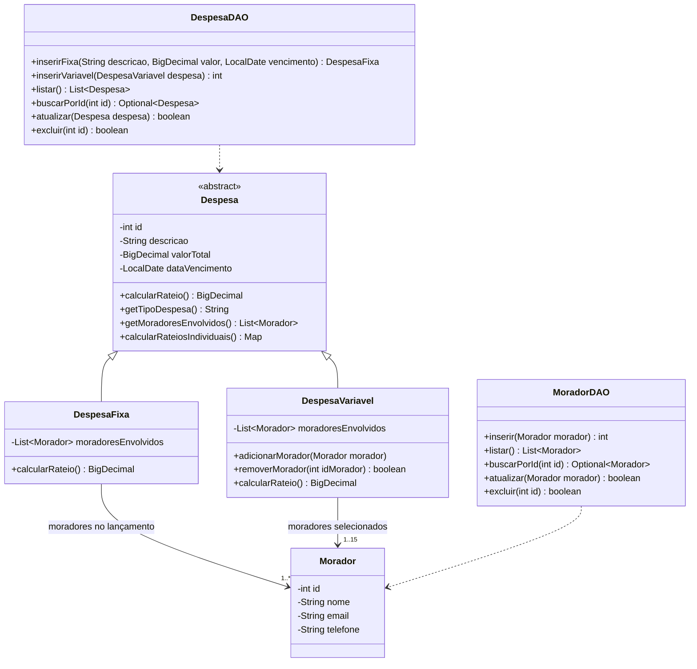

# Diagrama de classes

As multiplicidades se referem a despesas salvas. Cada morador pode participar de várias despesas e tem cadastro próprio. O RF01 limita o cadastro geral a 15 moradores e o RF03 limita cada despesa variável a 15 participantes.

A implementação trocou o `double` e o vetor da concepção por `BigDecimal` e listas tipadas. O Java distribui os centavos e os DAOs gravam os registros em transações JDBC. O MySQL mantém a integridade referencial. Conforme o [DER](diagrama-do-banco.png), a tabela `despesa_morador` registra participações no rateio, e o projeto não registra pagamentos. As regras de rateio ficam no Java, sem triggers ou procedimentos armazenados.
